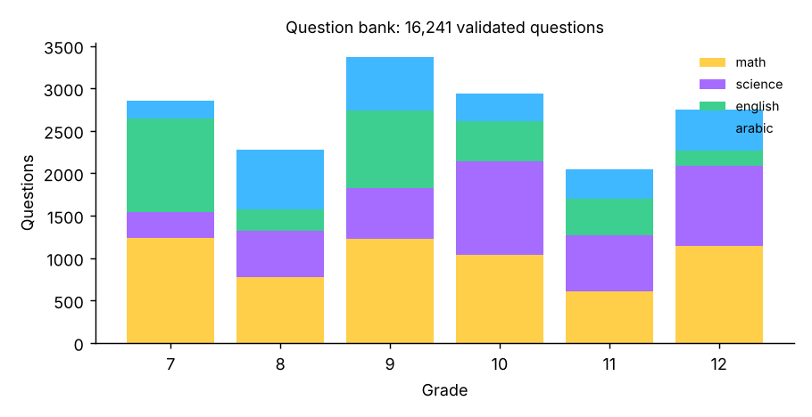
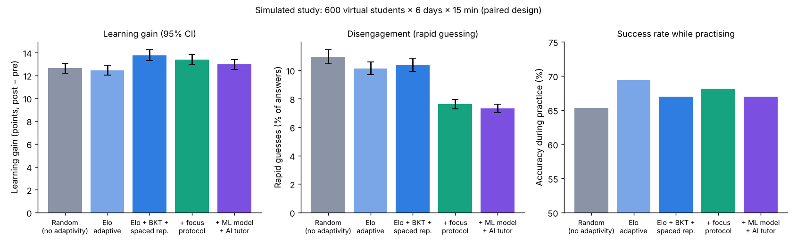

# Research report — Orbital Academy (computational phase)

> **Important:** every number below comes from **simulated students**, not real children. The simulation tests whether the algorithms behave sensibly, and it generates hypotheses. It does **not** prove the app improves learning. That needs a classroom pilot (see §5).

## 1. Research question
Can a game shell that turns curriculum questions into short "ship crises", combined with adaptive selection and a focus-protection protocol, improve learning and reduce disengagement (rapid guessing) compared with non-adaptive practice?

## 2. Question bank
- **16,241 questions**, 80 concepts, 4 subjects (math 6,051 · science 4,126 · English 3,362 · Arabic grammar 2,702), grades 7–12. Every student receives questions from **their own grade only** (checked by an automated test that draws 120 questions across the four subjects).
- Generated from templates with a fixed seed. **Every wrong option is a named misconception** with its own explanation.
- Validation (`tests/test-bank.js`): structural checks on all 13,656 questions. In addition, **4,660 numeric answers are re-solved by an independent parser** reading only the question text: 0 errors (this check caught one real display-rounding bug during development).
- Limitation: the Arabic and English templates were written by one author, and the **grade assigned to each concept is the developer's mapping, not copied from the official books** (`docs/CURRICULUM_MAP.md`). A teacher should review the map and a random sample (e.g. 200 questions) before the classroom pilot. Only the numeric science/maths answers are verified by an independent program; the grammar items are structurally validated but not independently solved.



## 3. Machine-learning models
Data: 706,553 answers from 2,500 simulated students. The simulated students use the same rule as the app: questions from their own grade only. The train/test split is **by student** (500 test students never seen in training).

| Model 1 — P(correct) | AUC | Brier | ECE |
|---|---|---|---|
| Constant baseline | 0.500 | 0.210 | — |
| Elo only | 0.623 | 0.203 | 0.030 |
| **Logistic regression (deployed)** | **0.635** | **0.199** | **0.003** |
| Gradient boosting | 0.643 | 0.198 | 0.002 |

| Model 2 — P(next answer is a rapid guess) | ROC-AUC | PR-AUC (base rate 0.106) |
|---|---|---|
| 1 − focus score (heuristic) | 0.635 | 0.174 |
| **Logistic regression (deployed)** | **0.664** | **0.203** |
| Gradient boosting | 0.669 | 0.209 |

At the deployed threshold (0.14), Model 2 flags 18% of moments, with precision 0.21 (2× the base rate) and recall 0.36.

**Interpretation:**
- The ML models beat their baselines, and they are well calibrated (ECE 0.003). This matters because the selection algorithm uses the *probability* itself.
- The gains are modest. Answering questions is noisy: published knowledge-tracing models typically reach AUC 0.70–0.80 on real data.
- Gradient boosting adds only about 0.01 AUC (0.643 vs 0.635). That justifies deploying the logistic regression, which is tiny, transparent, and runs in the browser.

Figures: `research/figures/roc.png`, `calibration.png`, `coefficients.png`.

## 4. Ablation study (5 policies, paired design)
600 virtual students × 6 days × 15 min. Every student plays all 5 policies with the same hidden parameters, so the policies are compared on identical students.

| Policy | Learning gain (pts) | vs random (paired) | Rapid guesses | Practice accuracy |
|---|---|---|---|---|
| Random questions | 12.63 ± 0.42 | — | 10.9% | 65.3% |
| Elo adaptive | 12.46 ± 0.42 | −0.17 (t = −0.9) | 10.1% | 69.4% |
| **Elo + BKT + spaced repetition** | **13.77 ± 0.46** | **+1.14 (t = 6.1, d_z = 0.25)** | 10.4% | 67.0% |
| + focus protocol | 13.41 ± 0.44 | +0.78 (t = 4.2) | **7.6%** | 68.2% |
| + ML model + AI tutor | 12.97 ± 0.43 | +0.34 (t = 1.9) | 7.3% | 66.9% |



**What the simulation says, honestly:**
1. **Targeting weak concepts plus spaced review is the component that raises learning:** about +9% over random, and it holds in all 4 assumption scenarios (+6% to +8%).
2. **Elo difficulty matching alone does not raise learning.** It does raise the success rate from 64% to 69%. More success could improve motivation, but the simulation does not model motivation.
3. **The focus protocol cuts rapid guessing by about 30%** (10.9% → 7.6%). Its breaks cost some practice time, so learning stays roughly the same as without it.
4. **The AI tutor pays off only if its explanations are strong enough** to justify their reading time. With a small effect (+0.15) it costs about as much time as it gives back (+2.7% vs random, t = 1.9, not clearly different). With a stronger effect (+0.35) the full system becomes the best policy (+9.4%). So the tutor's real effect is the key unknown to measure in the classroom.

Sensitivity analysis (`research/figures/sensitivity.png`, `research/RESULTS_TABLE.md`): the "learning zone" width is varied (σ = 0.6 / 1.0 / 1.6) and the tutor effect is raised (+0.35).

## 5. Next step: classroom pilot (needs IRB approval)
- **Design:** two classes, pre-test, then 2 weeks × 3 sessions of 10 minutes, then post-test (the same concepts as the bank).
  - Group A uses the full app.
  - Group B uses the same questions in a plain quiz with no game, no adaptivity, and no tutor.
- **Measures:**
  - learning gain
  - rapid-guess rate
  - tab switches
  - session completion
  - a short motivation questionnaire
- **Analysis:** ANCOVA on the post-test with the pre-test as a covariate.
- **Model update:** retrain both models on the real logs (the CSV export comes from the teacher dashboard) and compare their AUC with the simulated values.

## 6. Reproduce
```
npm run build && npm run sim:dataset && npm run train && npm run sim:ablation && npm run figures
```
Every step uses a fixed seed, so the results are identical each time.
